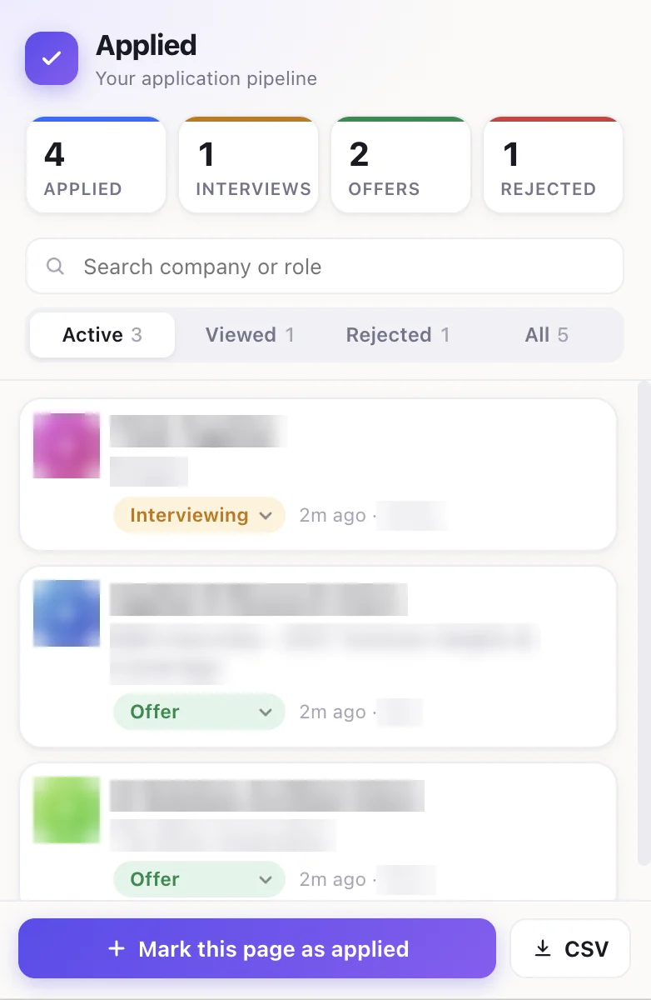

# Applied: Job Application Tracker

A Chrome extension that notices the jobs you look at and apply to, and keeps a status tracker in the toolbar popup. No account, no server. Everything is saved locally in your browser.

## Why I built it

Keeping a job tracker meant clicking away from every posting to a separate page and copying the title, company, and link over by hand. That extra step was easy to skip. Applied removes it: the tracker fills itself in as you browse, and you only open it to change a status.

## Install (about 1 minute)

1. Download this repo (**Code > Download ZIP**) and unzip it somewhere you'll keep it.
2. Go to `chrome://extensions` and turn on **Developer mode** (top right).
3. Click **Load unpacked** and pick the `applied-tracker` folder.
4. Pin it from the puzzle icon in the toolbar.

Pages that were already open before installing need a refresh.

## How it works

- **Viewed:** opening a job posting logs it automatically (Workday, LinkedIn, Handshake, Greenhouse, Lever, Ashby, plus most company career pages that publish standard job data).
- **Applied:** when a confirmation shows up ("Thank you for applying", LinkedIn's "Your application was sent", etc.), the job flips to Applied and the icon flashes a green check.
- **Interviewing / Offer / Rejected:** set these yourself from the dropdown.
- Click a title or company to edit it. **+ Mark this page as applied** covers anything detection missed. **Export CSV** downloads everything as a spreadsheet.
- Viewed jobs you never apply to clear out after 30 days.

## Privacy

The extension reads pages only to spot job postings and application confirmations. Jobs are stored with `chrome.storage.local` on your computer. Nothing is sent anywhere, and there are no analytics.

## Known limitations

- Detection relies on page text and layout, so a site redesign (LinkedIn changes often) can break title or company scraping. The manual button is the backup.
- Some company sites use custom confirmation wording that won't match. Add phrases to `CONFIRM_PATTERNS` in `content.js`.
- Workday "My Applications" pages that list old submissions can occasionally create an extra entry. Delete it from the popup.

## Files

- `content.js`: detects postings and confirmations on each page
- `background.js`: stores and de-duplicates jobs
- `popup.html / .css / .js`: the tracker UI
